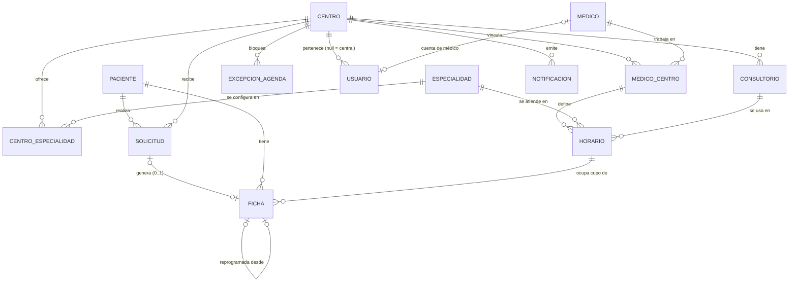

# DATA_MODEL — Entidades, relaciones y JSON semilla

> Todos los datos son **ficticios** y solo sirven para demostración.
> Documentos relacionados: [ARCHITECTURE.md](ARCHITECTURE.md) · [BUSINESS_RULES.md](BUSINESS_RULES.md)

---

## 1. Diagrama de entidades



Estructura conceptual (coincide con la propuesta del cliente, con dos precisiones):

```
CENTROS DE SALUD
 ├── Consultorios
 ├── Usuarios                 (admin central: centroId = null)
 ├── CentroEspecialidad  ──── Especialidades (catálogo global)
 ├── MedicoCentro        ──── Médicos (registro global)
 │     └── Horarios (plantilla semanal por médico+centro+especialidad)
 ├── Excepciones de agenda    (feriados, ausencias, permisos, bloqueos, ajustes)
 ├── Solicitudes  ──── Pacientes (registro global)
 │     └── Fichas
 └── Notificaciones
```

**Precisiones respecto al esquema conceptual propuesto:**

1. **Paciente es global**, no pertenece a un centro. Un ciudadano puede pedir fichas en varios centros con el mismo documento. La relación paciente ↔ centro se *deriva* de sus solicitudes/fichas, y un usuario de centro solo ve pacientes con actividad en su centro (BUSINESS_RULES RN-PAC-03).
2. **Especialidad = catálogo global + configuración por centro** (`CentroEspecialidad`). “Medicina General” es la misma especialidad en todos los centros (permite reportes globales), pero cada centro decide si la ofrece, sus fichas, horarios y si acepta solicitudes web. Esto cumple “cada centro administra sus propias especialidades” sin duplicar catálogos. *(Decisión D-06 en ROADMAP.)*

---

## 2. Convenciones

| Aspecto | Convención |
|---|---|
| IDs | `string` con prefijo legible en la semilla (`cen_001`, `med_004`). Los nuevos registros usan `prefijo_` + `crypto.randomUUID()` recortado. Nunca se reutiliza un ID. |
| Nombres de campos | `camelCase` en frontend; el adaptador API los convertirá a `snake_case` |
| Fecha (día) | `"YYYY-MM-DD"` en zona `America/La_Paz` (se muestra `DD/MM/YYYY`) |
| Hora | `"HH:mm"` (24 h) |
| Fecha-hora | ISO 8601 con offset: `"2026-11-05T08:15:00-04:00"` |
| Día de semana | ISO: `1` = lunes … `7` = domingo |
| Auditoría | Todos tienen `creadoEn`, `actualizadoEn`; operativos tienen `creadoPor`/`actualizadoPor` (usuarioId o `"publico"`) |
| Borrado | Lógico (`activo: false` o estado terminal). Solo se eliminan físicamente catálogos sin referencias. |
| Claves LocalStorage | `sipac:v1:<coleccion>` + `sipac:meta` |

---

## 3. Archivos JSON semilla

| Archivo | Colección | Contenido |
|---|---|---|
| `centros.json` | `centros` | 5 centros en 2 municipios (San José inactivo para demostrar la regla) |
| `consultorios.json` | `consultorios` | 3–5 por centro |
| `especialidades.json` | `especialidades` | Catálogo global (~8) |
| `centroEspecialidades.json` | `centroEspecialidades` | Configuración por centro |
| `medicos.json` | `medicos` | 23 profesionales (3 trabajan en dos centros) |
| `medicoCentros.json` | `medicoCentros` | Relación médico ↔ centro |
| `horarios.json` | `horarios` | Plantillas semanales |
| `agendas.json` | `excepcionesAgenda` | Feriados, ausencias, permisos, bloqueos, ajustes de cupo |
| `pacientes.json` | `pacientes` | 40 pacientes de escenario; el generador agrega ~340 sintéticos (`origen: "generado"`) |
| `solicitudes.json` | `solicitudes` | Escenarios fijos con fecha relativa (ver §6) |
| `fichas.json` | `fichas` | Escenarios fijos con fecha relativa (ver §6) |
| `usuarios.json` | `usuarios` | Credenciales demo de los 5 roles |
| `notificaciones.json` | `notificaciones` | Avisos iniciales |
| `escenario.json` | — | Parámetros del generador de actividad (semilla aleatoria, volumen, distribución) |

> “Agendas” se modela como **plantillas (`horarios`) + excepciones (`agendas.json`)**. La agenda de un día concreto no se guarda: se **calcula** (ver §5).

---

## 4. Entidades

### 4.1 Centro (`centros`)

| Campo | Tipo | Notas |
|---|---|---|
| id | string | `cen_001` |
| codigo | string | Código institucional **único**, p. ej. `BEN-TRI-0001` |
| codigoCorto | string | 3 letras, prefijo de códigos de solicitud (`CSC`) |
| nombre | string | |
| tipo | enum | `centro_salud`, `centro_salud_integral`, `puesto_salud`, `hospital_basico` |
| nivelAtencion | enum | `primer_nivel`, `segundo_nivel`, `tercer_nivel` |
| descripcion | string | |
| direccion, departamento, provincia, municipio, localidad | string | |
| latitud, longitud | number | |
| telefono, email | string | |
| imagen | string | Ruta en `/branding/centros/…` (imágenes genéricas) |
| horarioGeneral | array | `[{ dias:[1..5], apertura:"07:00", cierre:"19:00" }, { dias:[6], apertura:"08:00", cierre:"12:00" }]` |
| config | object | `{ diasAnticipacionMax: 14, cierreMismoDiaMin: 60, factorLimitePendientes: 2 }` |
| activo | boolean | |
| creadoEn, actualizadoEn | datetime | |

```json
{
  "id": "cen_001",
  "codigo": "BEN-TRI-0001",
  "codigoCorto": "CSC",
  "nombre": "Centro de Salud Central",
  "tipo": "centro_salud_integral",
  "nivelAtencion": "primer_nivel",
  "descripcion": "Establecimiento de primer nivel con atención ambulatoria y servicio de laboratorio básico (dato ficticio).",
  "direccion": "Calle Ficticia 123, zona central",
  "departamento": "Beni",
  "provincia": "Cercado",
  "municipio": "Trinidad",
  "localidad": "Trinidad",
  "latitud": -14.8336,
  "longitud": -64.9006,
  "telefono": "+591 3 0000001",
  "email": "central@demo-salud.bo",
  "imagen": "/branding/centros/central.svg",
  "horarioGeneral": [
    { "dias": [1, 2, 3, 4, 5], "apertura": "07:00", "cierre": "19:00" },
    { "dias": [6], "apertura": "08:00", "cierre": "12:00" }
  ],
  "config": { "diasAnticipacionMax": 14, "cierreMismoDiaMin": 60, "factorLimitePendientes": 2 },
  "activo": true,
  "creadoEn": "2026-01-10T09:00:00-04:00",
  "actualizadoEn": "2026-01-10T09:00:00-04:00"
}
```

Semilla: `cen_001` Central (Trinidad), `cen_002` Pompeya (Trinidad), `cen_003` Villa Corina (Trinidad), `cen_004` San José (**inactivo**, con historial). Coordenadas aproximadas en Trinidad; datos de contacto ficticios.

### 4.2 Consultorio (`consultorios`)

```json
{ "id": "con_001", "centroId": "cen_001", "nombre": "Consultorio 1", "piso": "Planta baja", "activo": true }
```

### 4.3 Especialidad — catálogo (`especialidades`)

```json
{
  "id": "esp_001",
  "codigo": "MG",
  "nombre": "Medicina General",
  "descripcion": "Consulta médica general para personas de todas las edades.",
  "icono": "MedicalServices",
  "activo": true
}
```

`codigo` es el prefijo del número de ficha (`MG-07`). `icono` es el nombre de un Material Icon. Catálogo semilla: MG Medicina General, PED Pediatría, GIN Ginecología, ODO Odontología, ENF Enfermería/Vacunas, NUT Nutrición, PSI Psicología, CPN Control Prenatal.

### 4.4 CentroEspecialidad (`centroEspecialidades`)

| Campo | Tipo | Notas |
|---|---|---|
| id | string | |
| centroId, especialidadId | string | **Único** por par |
| aceptaSolicitudesPublicas | boolean | Si `false` solo se emite en ventanilla |
| asignacionMedico | enum | `elegible` (el ciudadano elige o “cualquiera”) · `automatica` (siempre la asigna el sistema) |
| descripcionLocal | string? | Texto propio del centro |
| activo | boolean | |

```json
{
  "id": "ce_001",
  "centroId": "cen_001",
  "especialidadId": "esp_001",
  "aceptaSolicitudesPublicas": true,
  "asignacionMedico": "elegible",
  "descripcionLocal": null,
  "activo": true
}
```

Los **horarios y la cantidad de fichas** de la especialidad en el centro se obtienen de la suma de sus `horarios` (no se duplican aquí).

### 4.5 Médico (`medicos`) — registro global

```json
{
  "id": "med_001",
  "nombres": "Laura",
  "apellidos": "Méndez Ríos",
  "tipoDocumento": "CI",
  "numeroDocumento": "9000001",
  "registroProfesional": "MP-DEMO-0001",
  "foto": null,
  "especialidadIds": ["esp_001", "esp_008"],
  "telefono": "+591 70000001",
  "email": "lmendez@demo-salud.bo",
  "activo": true,
  "creadoEn": "2026-01-10T09:00:00-04:00",
  "actualizadoEn": "2026-01-10T09:00:00-04:00"
}
```

`foto: null` → avatar generado con iniciales (no se usan fotografías de personas reales). `numeroDocumento` y `registroProfesional` son **únicos**.

### 4.6 MedicoCentro (`medicoCentros`) — entidad intermedia

| Campo | Tipo | Notas |
|---|---|---|
| id | string | |
| medicoId, centroId | string | **Único** por par |
| especialidadIds | string[] | Subconjunto de `medico.especialidadIds` que ejerce **en este centro** |
| cargo | string? | “Médico de planta”, “Rotación” |
| fechaInicio, fechaFin | date / null | Vigencia del vínculo |
| activo | boolean | Desactivar aquí no afecta al médico en otros centros |

```json
{
  "id": "mc_001",
  "medicoId": "med_001",
  "centroId": "cen_001",
  "especialidadIds": ["esp_001"],
  "cargo": "Médico de planta",
  "fechaInicio": "2026-01-15",
  "fechaFin": null,
  "activo": true
}
```

Semilla: `med_001` trabaja en Central (lun–mié) y Pompeya (jue–vie) con agendas independientes.

### 4.7 Horario (`horarios`) — plantilla semanal

| Campo | Tipo | Notas |
|---|---|---|
| id | string | |
| centroId | string | Redundante con `medicoCentro.centroId` a propósito: simplifica filtros y aislamiento |
| medicoCentroId, medicoId | string | |
| especialidadId | string | Debe estar en `medicoCentro.especialidadIds` |
| consultorioId | string | Del mismo centro |
| diaSemana | 1–7 | |
| horaInicio, horaFin | HH:mm | |
| duracionConsultaMin | number | Para hora estimada |
| cupos | number | Máximo de fichas del bloque |
| cuposPublicos | number | ≤ `cupos`; los restantes se reservan para ventanilla |
| vigenciaDesde, vigenciaHasta | date / null | |
| activo | boolean | |

```json
{
  "id": "hor_001",
  "centroId": "cen_001",
  "medicoCentroId": "mc_001",
  "medicoId": "med_001",
  "especialidadId": "esp_001",
  "consultorioId": "con_001",
  "diaSemana": 1,
  "horaInicio": "08:00",
  "horaFin": "12:00",
  "duracionConsultaMin": 20,
  "cupos": 12,
  "cuposPublicos": 8,
  "vigenciaDesde": "2026-01-15",
  "vigenciaHasta": null,
  "activo": true
}
```

Validación: `cupos × duracionConsultaMin ≤ minutos del bloque`; sin solapamiento del mismo médico (en **cualquier** centro) ni del mismo consultorio en el mismo día y franja.

### 4.8 Excepción de agenda (`excepcionesAgenda`, archivo `agendas.json`)

| Campo | Tipo | Notas |
|---|---|---|
| id | string | |
| tipo | enum | `feriado`, `ausencia`, `permiso`, `bloqueo`, `ajuste_cupos` |
| alcance | enum | `global` (todos los centros), `centro`, `especialidad`, `medico`, `horario` |
| centroId | string / null | `null` solo si `alcance = global` |
| medicoId, especialidadId, horarioId | string / null | Según alcance |
| fechaInicio, fechaFin | date | Inclusive |
| horaInicio, horaFin | HH:mm / null | `null` = día completo |
| cuposAjustados | number / null | Solo `ajuste_cupos` |
| motivo | string | |
| creadoPor | string | |

```json
[
  { "id": "exc_001", "tipo": "feriado", "alcance": "global", "centroId": null, "medicoId": null, "especialidadId": null, "horarioId": null,
    "fechaInicio": "2026-11-18", "fechaFin": "2026-11-18", "horaInicio": null, "horaFin": null, "cuposAjustados": null,
    "motivo": "Feriado departamental (demo)", "creadoPor": "usr_001" },
  { "id": "exc_002", "tipo": "permiso", "alcance": "medico", "centroId": "cen_001", "medicoId": "med_003", "especialidadId": null, "horarioId": null,
    "fechaInicio": "@d+2", "fechaFin": "@d+3", "horaInicio": null, "horaFin": null, "cuposAjustados": null,
    "motivo": "Capacitación", "creadoPor": "usr_002" }
]
```

(`@d+2` = fecha relativa, ver §6.)

### 4.9 Paciente (`pacientes`) — registro global

```json
{
  "id": "pac_001",
  "tipoDocumento": "CI",
  "numeroDocumento": "1234567",
  "complemento": null,
  "nombres": "María",
  "apellidos": "Pérez Suárez",
  "fechaNacimiento": "1990-04-12",
  "sexo": "F",
  "telefono": "+591 71000001",
  "verificado": false,
  "bloqueo": { "activo": false, "motivo": null, "fichaId": null, "centroId": null, "desde": null },
  "historialBloqueos": [],
  "creadoEn": "2026-10-01T10:00:00-04:00",
  "actualizadoEn": "2026-10-01T10:00:00-04:00"
}
```

- `tipoDocumento`: `CI`, `CI_EXTRANJERO`, `PASAPORTE`, `CERTIFICADO_NACIMIENTO` (menores).
- Clave única: `tipoDocumento + numeroDocumento + complemento`.
- `sexo`: `F`, `M` o `null` (opcional; ver decisión D-09).
- `verificado`: lo marca recepción al presentar el documento físico.
- `bloqueo`: estado actual del bloqueo por inasistencia (RN-PAC-05). `historialBloqueos`: `[{ accion: "bloqueo" | "habilitacion", fecha, usuarioId, fichaId, centroId, nota }]`.
- `auditoria`: `[{ fecha, usuarioId, accion, cambios: [{ campo, antes, despues }] }]` — registro de ediciones (RN-PAC-10).
- **No se guarda información clínica** (motivo de consulta, diagnóstico, etc.).

### 4.10 Solicitud (`solicitudes`)

| Campo | Tipo | Notas |
|---|---|---|
| id | string | |
| codigo | string | Único global: `{codigoCorto}-{6 caracteres}` → `CSC-7K3F9Q` (alfabeto sin 0/O/1/I) |
| centroId, pacienteId, especialidadId | string | |
| fechaSolicitada | date | Día de atención deseado |
| medicoPreferidoId | string / null | `null` = “cualquier médico disponible” |
| canal | enum | `web`, `ventanilla` |
| estado | enum | `pendiente`, `aprobada`, `lista_espera`, `rechazada`, `cancelada`, `vencida` |
| motivoEstado | string / null | Motivo de rechazo/cancelación |
| fichaId | string / null | Se llena al aprobar |
| datosPorVerificar | boolean | Lo ingresado en el portal difiere del registro del paciente (RN-SOL-04) |
| datosIngresados | object / null | `{ nombres, apellidos, fechaNacimiento, telefono }` ingresados en el portal, para comparar (RN-PAC-11) |
| historial | array | `[{ estado, fecha, usuarioId, nota }]` |
| creadoEn, actualizadoEn, creadoPor | | |

```json
{
  "id": "sol_0001",
  "codigo": "CSC-7K3F9Q",
  "centroId": "cen_001",
  "pacienteId": "pac_001",
  "especialidadId": "esp_001",
  "fechaSolicitada": "@d+1",
  "medicoPreferidoId": null,
  "canal": "web",
  "estado": "aprobada",
  "motivoEstado": null,
  "fichaId": "fic_0001",
  "historial": [
    { "estado": "pendiente", "fecha": "@now-1h", "usuarioId": "publico", "nota": null },
    { "estado": "aprobada", "fecha": "@now-20m", "usuarioId": "usr_003", "nota": "Asignado automáticamente a Dra. Méndez" }
  ],
  "creadoPor": "publico",
  "creadoEn": "@now-1h",
  "actualizadoEn": "@now-20m"
}
```

### 4.11 Ficha (`fichas`)

| Campo | Tipo | Notas |
|---|---|---|
| id | string | |
| solicitudId | string / null | `null` en fichas de ventanilla sin solicitud previa |
| centroId, pacienteId, especialidadId, medicoId, horarioId, consultorioId | string | |
| fecha | date | |
| numero | number | Correlativo por **centro + especialidad + fecha** (no se reutiliza) |
| codigoVisible | string | `MG-07` (prefijo especialidad + número) |
| slot | number | Posición 1..cupos dentro del horario/fecha; **único** `(horarioId, fecha, slot)` entre fichas que ocupan cupo |
| horaEstimada | HH:mm | `horaInicio + (slot − 1) × duración` |
| canal | enum | `web`, `ventanilla` |
| estado | enum | `confirmada`, `en_espera`, `llamada`, `en_atencion`, `atendida`, `ausente`, `cancelada`, `reprogramada` |
| prioridad | enum | `normal`, `preferente` (decisión D-11) |
| fichaOrigenId | string / null | Si proviene de una reprogramación |
| llamadas | array | `[{ fecha, usuarioId }]` — repeticiones del llamado |
| emitidaEn, llegadaEn, llamadaEn, inicioAtencionEn, finAtencionEn, canceladaEn | datetime / null | Base de tiempos de espera y ausentismo |
| emitidaPor | string | usuarioId |
| motivoEstado | string / null | |

```json
{
  "id": "fic_0001",
  "solicitudId": "sol_0001",
  "centroId": "cen_001",
  "pacienteId": "pac_001",
  "especialidadId": "esp_001",
  "medicoId": "med_001",
  "horarioId": "hor_002",
  "consultorioId": "con_001",
  "fecha": "@d+1",
  "numero": 7,
  "codigoVisible": "MG-07",
  "slot": 7,
  "horaEstimada": "10:00",
  "canal": "web",
  "estado": "confirmada",
  "prioridad": "normal",
  "fichaOrigenId": null,
  "llamadas": [],
  "emitidaEn": "@now-20m",
  "llegadaEn": null,
  "llamadaEn": null,
  "inicioAtencionEn": null,
  "finAtencionEn": null,
  "canceladaEn": null,
  "emitidaPor": "usr_003",
  "motivoEstado": null
}
```

### 4.12 Usuario (`usuarios`)

```json
{
  "id": "usr_003",
  "username": "recepcion.central",
  "password": "Demo2026!",
  "nombre": "Rosa Vaca (demo)",
  "email": "recepcion.central@demo-salud.bo",
  "rol": "recepcionista",
  "centroId": "cen_001",
  "medicoId": null,
  "avatar": null,
  "activo": true,
  "ultimoAcceso": null
}
```

- `rol`: `admin_central`, `admin_centro`, `recepcionista`, `responsable_medico`, `medico`.
- `admin_central` → `centroId: null` (accede a todos).
- `medico` → `medicoId` obligatorio; sus centros = sus `medicoCentros` activos.
- **Contraseña en texto plano solo porque es una simulación** (ver ARCHITECTURE R4).

Credenciales demo (se documentarán también en `README.md`):

| Usuario | Contraseña | Rol | Centro |
|---|---|---|---|
| `admin.central` | `Demo2026!` | Administrador central | Todos |
| `admin.central.cs` | `Demo2026!` | Administrador de centro | Central |
| `recepcion.central` | `Demo2026!` | Recepcionista | Central |
| `responsable.central` | `Demo2026!` | Responsable médico | Central |
| `dra.mendez` | `Demo2026!` | Médico | Central y Pompeya |
| `admin.pompeya` | `Demo2026!` | Administrador de centro | Pompeya |
| `recepcion.pompeya` | `Demo2026!` | Recepcionista | Pompeya |
| `admin.villacorina` | `Demo2026!` | Administrador de centro | Villa Corina |
| `recepcion.villacorina` | `Demo2026!` | Recepcionista | Villa Corina |
| `dr.melgar` | `Demo2026!` | Médico | Central y Villa Corina |

### 4.13 Notificación (`notificaciones`)

```json
{
  "id": "ntf_001",
  "centroId": "cen_001",
  "destinoUsuarioId": null,
  "destinoRoles": ["recepcionista", "admin_centro"],
  "tipo": "solicitudes_pendientes",
  "titulo": "Solicitudes pendientes",
  "mensaje": "Hay 5 solicitudes pendientes para mañana en Medicina General.",
  "enlace": "/admin/solicitudes?estado=pendiente",
  "leidaPor": [],
  "creadoEn": "@now-30m"
}
```

Solo notificaciones internas del panel. `leidaPor` permite marcar leído por usuario.

### 4.14 Metadatos (`sipac:meta`, no es JSON semilla)

```json
{ "schemaVersion": 1, "sembradoEn": "2026-11-05T08:00:00-04:00", "fechaBase": "2026-11-05", "semilla": 20261105 }
```

---

## 5. Datos calculados (no persistidos)

| Concepto | Cálculo |
|---|---|
| **Bloque de agenda del día** | Para una fecha `F`: horarios activos, vigentes, con `diaSemana = isoWeekday(F)`, de médicos/vínculos/especialidades/centro activos, menos los anulados por excepciones (`feriado`, `ausencia`, `permiso`, `bloqueo`), con cupos modificados por `ajuste_cupos`. |
| **Cupos efectivos** | `cupos` del bloque (o `cuposAjustados`); 0 si está bloqueado. |
| **Cupos ocupados** | Fichas del `horarioId + fecha` con estado ∈ {`confirmada`, `en_espera`, `llamada`, `en_atencion`, `atendida`, `ausente`}. |
| **Cupos libres** | `efectivos − ocupados`. Públicos libres: `min(cuposPublicos − ocupadosWeb, libres)`. |
| **Médicos de turno (hoy/mañana)** | Médicos con al menos un bloque efectivo en la fecha, con horario, consultorio y estado: *Disponible* (hay cupos libres), *Sin cupos*, *En atención* (hay ficha `en_atencion` ahora), *Finalizado* (pasó `horaFin`). |
| **Fichas disponibles de una especialidad** | Suma de cupos públicos libres de sus bloques en la fecha consultada. |
| **Estado visible para el ciudadano** | Derivado de solicitud + ficha (ver BUSINESS_RULES §6.4). |

---

## 6. Fechas relativas y generador de actividad

**Problema:** fechas fijas en `solicitudes.json`/`fichas.json` envejecen y además, si se desplazan días, dejan de coincidir con el `diaSemana` de los horarios.

**Solución (decisión D-08):**

1. **Catálogos** (centros, consultorios, especialidades, médicos, vínculos, horarios, usuarios, pacientes) usan fechas absolutas — no dependen de “hoy”.
2. **Escenarios fijos** en `solicitudes.json`, `fichas.json`, `agendas.json` y `notificaciones.json` usan tokens relativos: `@d+1`, `@d-3`, `@now-20m`. Al sembrar, el resolvedor convierte el token y, para fichas/solicitudes, **ajusta al día hábil más cercano en que exista el horario referido** (hacia atrás para el pasado, hacia adelante para el futuro). Sirven para casos de demostración garantizados (una solicitud pendiente para mañana, un paciente en espera hoy, una ficha reprogramada, una rechazada, etc.).
3. **Volumen histórico** (últimos 8 días y próximos 7, configurable en `escenario.json`; limitado por la cuota de LocalStorage — ARCHITECTURE R3) lo produce `activityGenerator.js` con una semilla pseudoaleatoria determinista (`escenario.json`), recorriendo los bloques reales de agenda y **respetando cupos**, de modo que los KPIs y gráficos sean coherentes con los horarios. Distribuciones configurables: ocupación media por especialidad, % ausentismo, % cancelación, % canal web.
4. Tras sembrar, se ejecuta un **validador de integridad** (referencias existentes, mismo `centroId` en toda la cadena, sin cupos duplicados, sin exceder capacidad). Si falla en desarrollo, se muestra el error en consola.

---

## 7. Reglas de integridad referencial

| Relación | Regla |
|---|---|
| `horario.centroId` | = `medicoCentro.centroId` = `consultorio.centroId` |
| `horario.especialidadId` | ∈ `medicoCentro.especialidadIds` y existe `centroEspecialidad(centroId, especialidadId)` |
| `solicitud.especialidadId` | Debe estar ofrecida en `solicitud.centroId` |
| `ficha.*Id` | `centroId` de ficha = de solicitud = de horario = de consultorio |
| `ficha.medicoId` | = `horario.medicoId` |
| `solicitud.fichaId` ↔ `ficha.solicitudId` | Bidireccional y consistente |
| `usuario.medicoId` | Existe y está activo |
| Desactivar centro / médico / especialidad | Nunca borra registros relacionados |
| Eliminar físicamente | Solo catálogos sin referencias (p. ej. un consultorio recién creado por error) |

---

## 8. Correspondencia futura con MySQL

| Colección | Tabla | Índices clave |
|---|---|---|
| centros | `centros` | UNIQUE(`codigo`), UNIQUE(`codigo_corto`) |
| consultorios | `consultorios` | (`centro_id`) |
| especialidades | `especialidades` | UNIQUE(`codigo`) |
| centroEspecialidades | `centro_especialidad` | UNIQUE(`centro_id`,`especialidad_id`) |
| medicos | `medicos` + `medico_especialidad` | UNIQUE(`numero_documento`), UNIQUE(`registro_profesional`) |
| medicoCentros | `medico_centro` + `medico_centro_especialidad` | UNIQUE(`medico_id`,`centro_id`) |
| horarios | `horarios` | (`centro_id`,`dia_semana`), (`medico_id`,`dia_semana`) |
| excepcionesAgenda | `excepciones_agenda` | (`centro_id`,`fecha_inicio`,`fecha_fin`) |
| pacientes | `pacientes` | UNIQUE(`tipo_documento`,`numero_documento`,`complemento`) |
| solicitudes | `solicitudes` + `solicitud_historial` | UNIQUE(`codigo`), (`centro_id`,`fecha_solicitada`,`estado`) |
| fichas | `fichas` + `ficha_llamadas` | UNIQUE(`horario_id`,`fecha`,`slot`) parcial vía columna generada `ocupa_cupo`; UNIQUE(`centro_id`,`especialidad_id`,`fecha`,`numero`) |
| usuarios | `users` | UNIQUE(`username`), UNIQUE(`email`) |
| notificaciones | `notificaciones` + `notificacion_lecturas` | (`centro_id`,`created_at`) |
