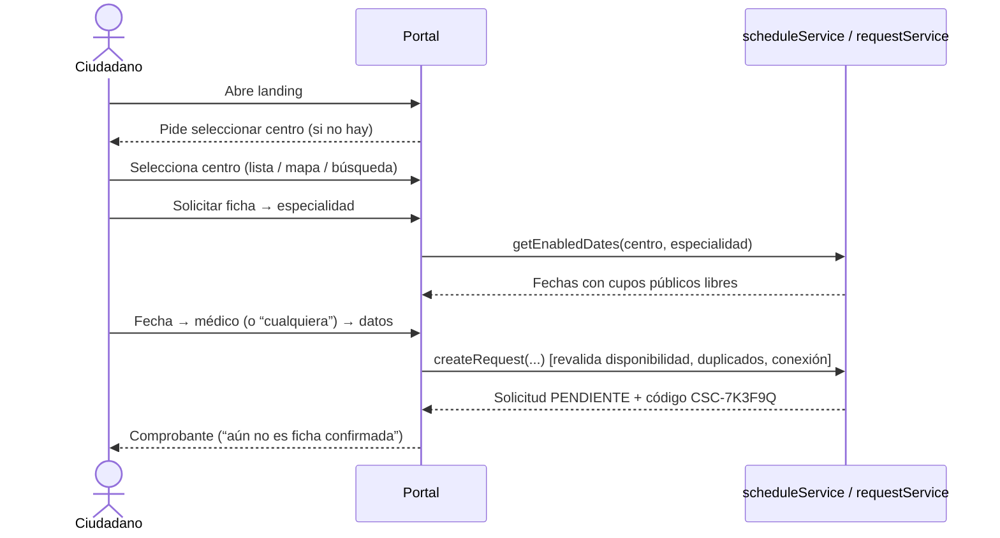

# ROADMAP — Sistema de Gestión de Fichas y Turnos Médicos (SIPAC)

> Prototipo estático (React + Vite + MUI + LocalStorage) para centros de salud públicos del departamento del Beni, desplegable en Vercel y preparado para migrar a Laravel + MySQL.
>
> | Documento | Contenido |
> |---|---|
> | **ROADMAP.md** (este) | Análisis, decisiones pendientes, flujos, épicas, hitos |
> | [ARCHITECTURE.md](ARCHITECTURE.md) | Capas, stack, carpetas, rutas, tema, PWA, riesgos de LocalStorage, migración |
> | [DATA_MODEL.md](DATA_MODEL.md) | Entidades, relaciones, ejemplos JSON, semilla relativa a hoy |
> | [BUSINESS_RULES.md](BUSINESS_RULES.md) | Reglas `RN-*`, máquinas de estado, permisos, fórmulas de indicadores |
>
> **Estado:** aprobado el 05/11/2026. Épicas 1 a 12 completadas; pendiente de revisión antes de la Épica 13.

---

## 1. Resumen del análisis

El núcleo del sistema es la **disponibilidad de cupos por centro + especialidad + médico + fecha**. Casi todos los módulos (portal, asistente, recepción, agenda, llamado, dashboard, reportes) consumen o modifican esa misma información, por lo que el orden de construcción gira en torno a tener primero:

1. el modelo multicentro con sus relaciones (`MedicoCentro`, `CentroEspecialidad`, `Horario`, `ExcepcionAgenda`);
2. un motor de disponibilidad puro y probado (`services/rules/availability.js`);
3. las máquinas de estado de **solicitud** y **ficha**, separadas.

La separación **Solicitud ≠ Ficha** resuelve el requisito “una solicitud pendiente no consume cupo”: la solicitud es la intención del ciudadano; la ficha es el cupo asignado. Solo la ficha ocupa capacidad.

---

## 2. Inconsistencias detectadas y decisiones pendientes

Las marcadas con **⚠ Requiere tu decisión** cambian comportamiento visible; el resto tiene una recomendación que aplicaré salvo que indiques otra cosa.

| ID | Tema | Hallazgo | Recomendación |
|---|---|---|---|
| D-01 | Identidad institucional | Usar nombre, escudo o logo de una institución real (Gobernación, SEDES) en un prototipo puede confundirse con un sistema oficial. | ✅ **Decidido:** el sistema se llama **SIPAC**. Institución genérica “Red Departamental de Salud — Demo” y logo placeholder, todo configurable en `src/config/app.config.js`. |
| D-02 | Lista de estados | Los 7 estados mezclan el ciclo de la solicitud y el de la ficha, y faltan estados que otros requisitos necesitan: *Ausente* (pantalla de llamado, ausentismo), *Llamada*, *Reprogramada*, *Vencida*, *Lista de espera*. | Dos máquinas de estado (BUSINESS_RULES §6.2 y §7.1) y una tabla de **estado visible** para el ciudadano que conserva tus 7 etiquetas y agrega las faltantes (§6.4). |
| D-03 | “Lista de espera” es ambigua | Se usa para (a) solicitudes que no alcanzaron cupo y (b) pacientes presentes esperando ser llamados (“Pacientes en espera” en el dashboard). | **Lista de espera** = solicitudes sin cupo (pestaña en Solicitudes). **Sala de espera** = fichas `en_espera` del día (Entrega de fichas, dashboard, pantalla de llamado). ✅ **Decidido.** |
| D-04 | “Aprobar” vs “Emitir ficha” | Aparecen como acciones distintas, pero una aprobación sin ficha no tiene significado operativo y obliga a un estado intermedio sin cupo. | **Aprobar = emitir ficha** en una sola operación (“Aprobar y emitir”). “Emitir ficha” queda para **fichas de ventanilla** (paciente presente sin solicitud web), práctica habitual en centros de primer nivel. |
| D-05 | Módulo “Entrega de fichas” | No se define en qué se diferencia de “Solicitudes de fichas”. | **Solicitudes** = back-office (aprobar, rechazar, lista de espera). **Entrega** = mostrador del día: registrar llegada, emitir fichas de ventanilla, sala de espera y controles de llamado. |
| D-06 | Especialidades “propias” de cada centro | Duplicar “Medicina General” por centro impide reportes globales por especialidad. | Catálogo **global** + configuración por centro (`CentroEspecialidad`). DATA_MODEL §1. |
| D-07 | Pacientes por centro | El esquema conceptual ubica Pacientes bajo Centros, pero un ciudadano puede ir a varios centros con el mismo documento. | Paciente **global**; la visibilidad por centro se deriva de sus solicitudes/fichas (RN-PAC-03). |
| D-08 | Datos semilla que envejecen | Fechas fijas en `solicitudes.json`/`fichas.json` dejan el dashboard vacío en pocos días y desalinean los días de semana. | Tokens relativos (`@d+1`) + generador determinista que respeta horarios y cupos (DATA_MODEL §6). Los JSON siguen siendo la fuente. |
| D-09 | Campo “sexo” | Pedido “solo si resulta necesario”. | Campo **opcional** en el formulario; no se usa en reglas. Se puede quitar con un flag de configuración. |
| D-10 | Cupos web vs ventanilla | Si el 100 % de cupos se asigna por web, la población sin internet queda excluida. | `cuposPublicos` por horario (p. ej. 8 de 12); el resto se reserva para ventanilla. ✅ **Decidido.** |
| D-11 | Atención preferente | No mencionada; en Bolivia existe atención preferente (adultos mayores, gestantes, personas con discapacidad). | Marca `prioridad: preferente` que solo reordena el llamado. ✅ **Decidido.** |
| D-12 | Definición de indicadores | “Fichas emitidas hoy” (¿para hoy o emitidas hoy?) y “distribución por horario” (¿hora de solicitud o franja de atención?) son ambiguas. | Emitidas = fichas **para atención hoy**; distribución = por **franja de atención** (1 h). Fórmulas únicas en BUSINESS_RULES §10. |
| D-13 | Gestión de usuarios | El rol Administrador central “administra usuarios”, pero no hay opción en el sidebar. | Agregar **“Usuarios”** al sidebar (solo admin central). |
| D-14 | Cancelación por el ciudadano | No especificada. | Permitir cancelar desde “Consultar solicitud” (código + documento) mientras esté `pendiente`, `lista_espera` o `confirmada` y falten ≥ 2 h. Libera el cupo. ✅ **Decidido.** |
| D-22 | Inasistencia | Decisión del cliente: quien saca ficha y no se presenta queda bloqueado. | ✅ **Decidido:** al marcarse `ausente`, el paciente queda **bloqueado para nuevas fichas** hasta que un usuario autorizado lo habilite manualmente (BUSINESS_RULES RN-PAC-05 a RN-PAC-09). |
| D-15 | “Asignar horario” | Las fichas se emiten sobre bloques de horario; asignar una hora libre no encaja con la atención por orden de llegada. | “Asignar horario” = elegir **bloque** (médico/franja) al aprobar o reprogramar; la hora mostrada es **estimada** a partir del orden. |
| D-16 | Offline vs LocalStorage | En el prototipo todo es local, así que “enviar sin conexión” técnicamente funcionaría. | **Bloquear escrituras sin conexión** para simular fielmente el comportamiento con servidor (RN-OFF-01). |
| D-17 | Multi-dispositivo | La pantalla de TV, el celular del ciudadano y la PC de recepción no comparten LocalStorage. | Demo en **un mismo navegador** (pestañas/ventanas sincronizadas por evento `storage`). Se documenta como limitación. |
| D-18 | Mapa y “sin servicios externos” | Leaflet necesita teselas de OpenStreetMap (internet). | El mapa es complementario; sin conexión se muestra la vista de tarjetas. |
| D-19 | Calendario de agenda | MUI no incluye vista día/semana/mes. | Componentes propios sobre MUI (evita FullCalendar); `@mui/x-date-pickers` solo para selección de fechas. |
| D-20 | Aprobación automática | No se pide, pero sin ella el ciudadano depende de que recepción revise. | Aprobación **manual** en esta etapa; dejar preparado el flag `aprobacionAutomatica` en `CentroEspecialidad` para una fase posterior. |
| D-21 | Ubicación del proyecto | — | Carpeta `fichas-medicas-beni/` dentro de `~/Escritorio/proyectos/`. |

---

## 3. Flujos principales

### F1. Ciudadano solicita una ficha



### F2. Recepción aprueba y emite
Solicitudes → pestaña *Pendientes* (filtrada por fecha/especialidad) → Ver detalle → **Aprobar y emitir** (médico preferido o automático, RN-APR-02) → validación de cupo y slot (RN-APR-03/04) → ficha `confirmada` `MG-07` con hora estimada → notificación interna. Si no hay cupo: **Pasar a lista de espera** o **Rechazar** con motivo.

### F3. Ciudadano consulta su solicitud
Consultar → código + documento → estado visible (§6.4), centro, especialidad, médico, ficha, hora estimada → opción *Cancelar* (D-14) → imprimir comprobante.

### F4. Día de atención: entrega, sala y llamado
Paciente llega → Entrega de fichas → buscar por código/documento → **Registrar llegada** (`en_espera`) → aparece en *Sala de espera* y en la pantalla de TV → **Llamar siguiente** (consultorio) → `llamada` (pantalla destaca `MG-07 · Consultorio 1`) → **Repetir** / **Ausente** / **Iniciar atención** → **Atendido**. Al final: **Cierre de jornada** (RN-FIC-06).

### F5. Ficha de ventanilla
Paciente sin solicitud → Entrega → **Emitir ficha** → buscar/crear paciente → especialidad + bloque con cupo (usa cupos totales) → ficha `confirmada` → opcional registrar llegada inmediata.

### F6. Reprogramación / cancelación
Detalle de ficha → **Reprogramar** → elegir fecha/bloque con cupo → original `reprogramada`, nueva `confirmada` (RN-FIC-08). Si se liberan cupos y hay lista de espera para ese bloque → notificación a recepción.

### F7. Configuración de agenda
Responsable médico → Médicos (vincular al centro, especialidades) → Horarios (plantilla semanal, cupos, cupos públicos, consultorio) → Agenda (ver ocupación, registrar ausencias/permisos/feriados/bloqueos; si afectan fichas, resolver en lote — RN-AGE-02).

### F8. Administrador central
Login → selector de centro en navbar (o “Todos” en dashboard/reportes) → Centros (crear, desactivar) → Usuarios → Reportes globales.

### F9. Sin conexión
Banner “Sin conexión” → navegación y lecturas funcionan con datos cacheados → cualquier acción de escritura muestra “No hay conexión. La operación **no** se realizó.” → al reconectar, aviso “Conexión restablecida”.

### F10. Restaurar demo
Configuración → **Restaurar datos de demostración** → confirmación → re-siembra relativa a hoy → cierre de sesión.

---

## 4. Épicas

Convención: **HU** = historia de usuario; **CA** = criterio de aceptación. Las reglas `RN-*` están en BUSINESS_RULES.md.

---

### Épica 1 — Configuración inicial y arquitectura

**Objetivo:** proyecto base ejecutable con la capa de datos multicentro y las reglas núcleo funcionando y probadas, antes de construir pantallas.

**Funcionalidades:** proyecto Vite + dependencias; estructura de carpetas; `app.config.js`; utilidades de fecha (La Paz, DD/MM/YYYY); DataSource local con transacciones y evento de cambios; repositorios; JSON semilla; inicializador + generador de actividad + validador de integridad; motor de disponibilidad; máquinas de estado; `AppError`; router con rutas vacías; `vercel.json`.

**HU:**
- Como desarrollador, quiero una capa de servicios asíncrona para que los componentes no dependan de LocalStorage.
- Como presentador de la demo, quiero que los datos se generen relativos a hoy para que el sistema siempre luzca “vivo”.

**Tareas técnicas:**
1. `npm create vite` (React JS), instalar dependencias (ARCHITECTURE §3), ESLint/Prettier, alias `@/`.
2. `config/app.config.js`, `config/constants.js` (estados, roles, permisos).
3. `utils/dates.js` con dayjs + timezone; pruebas de formato y “hoy”.
4. `datasource/localDataSource.js` (claves `sipac:v1:*`, `transaction`, emisión de `data:changed`, bloqueo de escritura offline), `apiDataSource.js` stub.
5. `createRepository`, `errors.js`.
6. JSON semilla completos (DATA_MODEL §3) para 4 centros.
7. `seed/initDemoData.js`, `activityGenerator.js`, validador de integridad.
8. `rules/availability.js`, `rules/stateMachines.js` + pruebas Vitest.
9. `routes.config.js` + `AppRouter` con placeholders; `vercel.json`.

**Dependencias:** ninguna.

**CA:**
- `npm run dev` y `npm run build` funcionan sin errores ni warnings de ESLint.
- Al abrir por primera vez se siembran los datos; el validador de integridad reporta 0 errores.
- Hay solicitudes en los últimos 7 días y bloques con cupos hoy/mañana, sin importar la fecha de ejecución.
- Pruebas: disponibilidad (feriado anula, ajuste de cupos, cupos públicos, pendientes no consumen), transiciones válidas/inválidas.
- Ningún componente importa JSON de `src/data/` directamente (verificable por búsqueda).

**Resultado esperado:** esqueleto navegable y núcleo de dominio probado.

---

### Épica 2 — Diseño visual, temas y componentes comunes

**Objetivo:** identidad institucional coherente, modo oscuro y biblioteca de componentes reutilizables.

**Funcionalidades:** tema claro/oscuro (paleta solicitada), Roboto local, overrides MUI; `ColorModeContext` persistente; `NotifyContext` (Snackbar); `PublicLayout`, `AdminLayout` (navbar + sidebar colapsable/responsive), `DisplayLayout`; componentes comunes: `PageHeader`, `DataTable` (búsqueda, orden, paginación, vacío, skeleton), `StatusChip` (todos los estados), `ConfirmDialog`, `EmptyState`, `KpiCard`, `ChartCard`, `FormField*` (RHF), `OfflineBanner`, `DemoBadge`; `useChartColors`.

**HU:**
- Como usuario, quiero activar el modo oscuro y que se recuerde mi preferencia.
- Como ciudadano en un celular, quiero que el sitio se vea bien y sea fácil de tocar.

**Tareas técnicas:** `theme/*`, contextos, layouts, componentes; página interna `/dev/componentes` (solo en desarrollo) para revisar todos los componentes en ambos modos.

**Dependencias:** Épica 1.

**CA:**
- El modo oscuro se aplica a navbar, sidebar, tarjetas, tablas, formularios, diálogos, gráficos de ejemplo y persiste tras recargar.
- Contraste AA verificado en textos y chips en ambos modos.
- Sidebar colapsable en escritorio y como drawer temporal < 900 px.
- Ninguna pantalla genera scroll horizontal a 360 px.

**Resultado esperado:** base visual lista para construir módulos sin rediseñar.

---

### Épica 3 — Centros de salud y selector de establecimientos

**Objetivo:** el ciudadano puede encontrar y seleccionar un centro, y la selección persiste.

**Funcionalidades:** `centerService`; `CenterContext`; `CenterSelector` (diálogo/autocompletar en header) con búsqueda, filtros por municipio y tipo; catálogo `/centros` en tarjetas y mapa (Leaflet + OSM), distancia opcional (geolocalización + Haversine); detalle `/centros/:codigo`; `SelectedCenterBanner` (tarjeta destacada).

**HU:**
- Como ciudadano, quiero buscar un centro por nombre o municipio y ver dirección, teléfono y ubicación.
- Como ciudadano, quiero que el centro elegido se mantenga mientras navego.

**Tareas técnicas:** servicio con filtros; contexto con persistencia; componentes de tarjeta, mapa (carga diferida), detalle; manejo de centro inactivo (RN-CEN-05).

**Dependencias:** Épicas 1–2.

**CA:**
- Solo aparecen centros activos; San José (inactivo) no aparece.
- Filtros y búsqueda combinables; estado vacío con acción “Limpiar filtros”.
- Tarjetas ↔ mapa conservan filtros; clic en marcador muestra resumen y “Seleccionar”.
- Sin conexión, la vista mapa muestra un aviso y la vista tarjetas sigue funcionando.
- Con permiso de ubicación se muestran distancias y orden por cercanía; sin permiso, no hay error.

**Resultado esperado:** selector multicentro funcional y reutilizable en el asistente y el panel.

---

### Épica 4 — Portal público

**Objetivo:** landing institucional y páginas informativas dependientes del centro seleccionado.

**Funcionalidades:** header completo (logo, nombre, selector, menú, “Solicitar ficha”); hero con CTA y centro seleccionado; bloque “Seleccione un centro” cuando no hay selección; Especialidades (icono, descripción, horario, fichas disponibles, médicos); Médicos de turno hoy/mañana (estado de disponibilidad); Horarios (generales y por especialidad, días diferenciados); footer con datos configurables y aviso de demostración.

**HU:**
- Como ciudadano, quiero ver qué médicos atienden hoy y mañana en mi centro.
- Como ciudadano, quiero saber cuántas fichas quedan en una especialidad antes de solicitar.

**Tareas técnicas:** `specialtyService`, `doctorService.getDoctorsOnDuty`, `scheduleService.getDaySummary`; páginas; skeletons; SEO básico (title/description).

**Dependencias:** Épica 3.

**CA:**
- Cambiar de centro actualiza especialidades, médicos y horarios sin recargar.
- Los médicos de turno reflejan horarios + excepciones (un médico con permiso mañana no aparece mañana).
- “Fichas disponibles” coincide con el cálculo del motor de disponibilidad (cupos públicos libres).
- Sin centro seleccionado, los botones de solicitud llevan a seleccionar centro primero.
- Todos los enlaces del header funcionan en escritorio y en menú móvil.

**Resultado esperado:** portal público completo y coherente con los datos.

---

### Épica 5 — Solicitud y consulta de fichas

**Objetivo:** el ciudadano puede solicitar una ficha en 7 pasos y consultar su estado.

**Funcionalidades:** asistente (Stepper MUI; vertical en móvil) con los 7 pasos; calendario con fechas habilitadas (`shouldDisableDate`); médico elegible o “cualquiera” (RN-ESP-05); formulario RHF + Zod; confirmación; comprobante imprimible; consulta pública con enmascarado; cancelación ciudadana (D-14); bloqueo de pacientes inhabilitados por inasistencia (D-22).

**HU:**
- Como ciudadano, quiero elegir especialidad, fecha y médico y recibir un código para dar seguimiento.
- Como ciudadano, quiero consultar con mi código y documento si mi ficha fue confirmada.

**Tareas técnicas:** `requestService.createRequest` / `getPublicStatus` / `cancelByCitizen`; `patientService.findOrCreatePublic` (RN-SOL-04); generador de códigos; vista de impresión (`@media print`); estado del asistente preservado al retroceder.

**Dependencias:** Épicas 3–4.

**CA:**
- No se pueden elegir fechas pasadas, fuera de ventana, sin horario, bloqueadas o sin cupos públicos.
- Si la disponibilidad cambia durante el asistente, la confirmación falla con mensaje claro y vuelve al paso de fecha.
- Una segunda solicitud para mismo centro + especialidad + fecha + documento es rechazada (RN-SOL-02).
- La solicitud creada queda `pendiente` y **no** reduce las fichas disponibles mostradas.
- El comprobante muestra código, centro, paciente, especialidad, médico (o “Por asignar”), fecha, horario estimado y estado.
- Sin conexión, el botón confirmar muestra el error y no se genera comprobante.
- La consulta con código correcto y documento incorrecto muestra el mensaje genérico.

**Resultado esperado:** flujo ciudadano completo extremo a extremo.

---

### Épica 6 — Autenticación y perfiles

**Objetivo:** acceso simulado por rol, aislamiento por centro y permisos aplicados en rutas, menú y servicios.

**Funcionalidades:** login (credenciales demo visibles en un panel desplegable “Usuarios de demostración”); `AuthContext` con expiración; `ProtectedRoute` por permiso; sidebar filtrado; selector de centro en navbar (admin central y médico multicentro); menú de usuario (Mi perfil, Cambiar contraseña simulado, Configuración, Cerrar sesión); `assertCenterAccess` / `assertPermission` en servicios.

**HU:**
- Como recepcionista, quiero entrar y ver solo la información de mi centro.
- Como administrador central, quiero cambiar de centro desde el navbar.

**Tareas técnicas:** `authService`, `userService`, matriz de permisos en `constants.js`, pantalla de perfil y cambio de contraseña, página 403.

**Dependencias:** Épicas 1–2.

**CA:**
- Cada usuario demo ve exactamente las opciones de la matriz (BUSINESS_RULES §9).
- Escribir una URL sin permiso muestra 403, no la pantalla.
- Una llamada de servicio con `centroId` ajeno lanza `ACCESO_DENEGADO` (prueba automatizada).
- La sesión expira y redirige a login conservando la ruta de destino.
- Credenciales documentadas en README.

**Resultado esperado:** panel con seguridad simulada consistente.

---

### Épica 7 — Panel administrativo y dashboard

**Objetivo:** visión operativa del centro activo con indicadores calculados.

**Funcionalidades:** 6 KPI cards; 4 gráficos Recharts (últimos 7 días, por especialidad, emitidas vs atendidas, distribución por franja); insights dinámicos; notificaciones en navbar (contador, lista, marcar leídas, enlace); vista “Todos los centros” para admin central; vista reducida para médico (su agenda de hoy).

**HU:**
- Como administrador de centro, quiero ver al iniciar el día cuántas fichas quedan y cuántas solicitudes faltan revisar.

**Tareas técnicas:** `rules/kpis.js`, `rules/insights.js` con pruebas; `reportService.getDashboard`; `notificationService`; componentes de gráficos con `useChartColors`.

**Dependencias:** Épicas 2, 6.

**CA:**
- Cada KPI coincide con un recuento manual sobre los datos (pruebas con dataset fijo).
- Aprobar una solicitud en otra pestaña actualiza el dashboard sin recargar.
- Los insights cambian al cambiar de centro y solo aparecen los que aplican.
- Gráficos legibles en modo oscuro y responsivos.

**Resultado esperado:** dashboard confiable, sin números estáticos.

---

### Épica 8 — Gestión de solicitudes y entrega de fichas

**Objetivo:** operación diaria de recepción respetando capacidad y sin cupos duplicados.

**Funcionalidades:**
- *Solicitudes:* pestañas Pendientes · Fichas emitidas · Lista de espera · Canceladas/Rechazadas; búsqueda; filtros fecha/especialidad/médico/estado; detalle con historial; acciones Aprobar y emitir, Rechazar, Pasar a lista de espera, Asignar médico/bloque, Reprogramar, Cancelar.
- *Entrega:* búsqueda rápida por código/documento; Registrar llegada; Emitir ficha de ventanilla; Sala de espera por consultorio; controles de llamado (Llamar siguiente, Repetir, Ausente, Iniciar, Atendido); Cierre de jornada.

**HU:**
- Como recepcionista, quiero aprobar solicitudes sabiendo que el sistema no me deja exceder los cupos.
- Como recepcionista, quiero emitir fichas a quienes llegan sin solicitud.

**Tareas técnicas:** `requestService.approve/reject/moveToWaitlist/cancel`; `appointmentService.issueWalkIn/checkIn/reschedule/cancel/closeDay`; `queueService`; diálogo de aprobación con bloques disponibles y cupos en tiempo real; prevención de doble envío (botón deshabilitado + verificación de slot).

**Dependencias:** Épicas 5, 6, 7 (notificaciones).

**CA:**
- Con 1 cupo libre, aprobar dos solicitudes (incluso en dos pestañas) emite solo una; la otra recibe `CUPO_AGOTADO`.
- Ningún par `(horarioId, fecha, slot)` repetido tras cualquier secuencia de operaciones (prueba automatizada).
- Las fichas de ventanilla pueden usar cupos no públicos; las web no.
- Cancelar/reprogramar libera el cupo y, si hay lista de espera para ese bloque, genera notificación.
- Todas las acciones exigen confirmación y muestran Snackbar de resultado; rechazar y cancelar exigen motivo.
- El historial de la solicitud refleja cada acción con usuario y hora.

**Resultado esperado:** ciclo completo solicitud → ficha → atención operable desde el panel.

---

### Épica 9 — Médicos, especialidades y agendas

**Objetivo:** configurar la oferta del centro: médicos, especialidades, horarios y excepciones, con vista de agenda.

**Funcionalidades:**
- *Médicos:* listado, crear/editar, activar/desactivar, vincular a centros (detección de duplicado por documento → vincular), especialidades en el centro, ver agenda y fichas.
- *Especialidades:* activar del catálogo para el centro, editar configuración (acepta web, asignación de médico), ver médicos y horarios; catálogo global (admin central).
- *Horarios:* CRUD de plantillas con validación de solapamiento y capacidad.
- *Agenda:* vistas Día / Semana / Mes (componentes propios) con cupos libres/ocupados por bloque; registrar ausencias, permisos, feriados, bloqueos, ajustes de cupos con resolución de fichas afectadas.

**HU:**
- Como responsable médico, quiero registrar el permiso de un médico y reprogramar sus fichas afectadas.
- Como responsable médico, quiero vincular a un médico que ya trabaja en otro centro sin duplicar su registro.

**Tareas técnicas:** `doctorService`, `specialtyService`, `scheduleService` (CRUD + `getAgenda(rango)`), componentes `Agenda*View`, diálogos de excepción y resolución en lote.

**Dependencias:** Épicas 1, 6, 8 (reprogramación).

**CA:**
- No se puede crear un horario solapado para el mismo médico en otro centro (mensaje indica cuál).
- Un feriado global vacía la disponibilidad pública de ese día en todos los centros.
- Desactivar un vínculo no afecta al médico en el otro centro.
- La agenda semanal muestra para cada bloque `ocupados/efectivos` y se actualiza al emitir fichas.
- Los cambios se reflejan inmediatamente en portal público (médicos de turno, fechas habilitadas).

**Resultado esperado:** oferta asistencial configurable por centro.

---

### Épica 10 — Gestión de pacientes

**Objetivo:** consulta administrativa de pacientes e historial de solicitudes/fichas, sin historia clínica.

**Funcionalidades:** listado con búsqueda por documento/nombre; detalle (datos, verificado, solicitudes y fichas filtradas al centro); editar datos y marcar verificado; resolver “datos por verificar”.

**HU:** Como recepcionista, quiero buscar a un paciente por su CI y ver sus fichas anteriores en este centro.

**Tareas técnicas:** `patientService` con regla RN-PAC-03; páginas listado y detalle.

**Dependencias:** Épicas 6, 8.

**CA:**
- Un recepcionista de Pompeya no ve pacientes que solo tienen fichas en Central.
- No existe ningún campo clínico en formularios ni detalle.
- Editar un paciente queda registrado (usuario y fecha).

**Resultado esperado:** módulo administrativo de pacientes con privacidad por centro.

---

### Épica 11 — Llamado de pacientes

**Objetivo:** pantalla para TV de sala de espera sincronizada con los controles de recepción.

**Funcionalidades:** `/pantalla/:codigoCentro` en pantalla completa: llamado actual por consultorio, últimos llamados, próximos; animación y sonido al llamar/repetir; reloj y fecha; modo oscuro de alto contraste por defecto; reconexión/refresco periódico.

**HU:** Como paciente en sala, quiero ver claramente cuándo llaman mi número y a qué consultorio ir.

**Tareas técnicas:** `queueService.getBoard`; `DisplayLayout`; suscripción a `data:changed` + polling 30 s; `Fullscreen API`; síntesis de voz opcional.

**Dependencias:** Épica 8.

**CA:**
- “Llamar siguiente” en recepción aparece en la pantalla (otra ventana) en < 2 s.
- Legible a 5 m en 1080p (número ≥ 120 px); no muestra nombres ni documentos.
- Funciona sin sesión iniciada y no expone controles.

**Resultado esperado:** experiencia de sala de espera demostrable.

---

### Épica 12 — Reportes

**Objetivo:** indicadores filtrables, exportables e imprimibles.

**Funcionalidades:** filtros centro (solo central puede elegir “Todos”), rango de fechas, especialidad, médico; indicadores de BUSINESS_RULES §10 (emitidas, atendidas, canceladas, ausentismo, rechazadas, demanda por especialidad, tiempo de espera); tablas y gráficos; exportar CSV (UTF-8 con BOM para Excel, separador `;`); vista de impresión con encabezado institucional y filtros aplicados.

**HU:** Como administrador central, quiero comparar ausentismo entre centros en el último mes y exportarlo.

**Tareas técnicas:** `reportService`, `utils/csv.js`, hojas de estilo de impresión.

**Dependencias:** Épicas 7, 8.

**CA:**
- Los totales del reporte coinciden con el dashboard para el mismo día y centro.
- El CSV abre correctamente en Excel con tildes y fechas DD/MM/YYYY.
- La vista de impresión oculta navegación y se ajusta a A4/Carta.

**Resultado esperado:** reportes listos para presentar a autoridades.

---

### Épica 13 — PWA y despliegue

**Objetivo:** aplicación instalable, con caché offline y publicada en Vercel.

**Funcionalidades:** manifest (nombre, colores, iconos 192/512/maskable), Service Worker (Workbox vía `vite-plugin-pwa`), botón Instalar, aviso de nueva versión, banner sin conexión, bloqueo de escrituras offline verificado, despliegue en Vercel con rewrites.

**HU:** Como ciudadano, quiero instalar el sistema en mi celular y consultar la información aunque pierda la señal.

**Tareas técnicas:** configuración PWA, iconos, `useInstallPrompt`, pruebas Lighthouse, `vercel.json`, variables de entorno en Vercel, README de despliegue.

**Dependencias:** Épicas 1–12 (puede empezar en paralelo desde la 5).

**CA:**
- Lighthouse: PWA instalable, Accesibilidad ≥ 90, Rendimiento ≥ 80 (móvil).
- Recargar sin conexión muestra la app y páginas visitadas.
- Ninguna operación de escritura “tiene éxito” sin conexión.
- Rutas profundas (`/admin/agenda`) funcionan al recargar en Vercel.

**Resultado esperado:** URL pública de demostración.

---

### Épica 14 — Pruebas y ajustes finales

**Objetivo:** calidad de demo “producto real”: sin botones muertos, datos coherentes, accesible.

**Funcionalidades:** suite Vitest de reglas y servicios; recorrido manual guiado por rol (guion de demostración); auditoría de botones sin acción; revisión responsive (360 / 768 / 1280 / 1920); revisión de textos en español y formatos; validador de integridad tras operaciones aleatorias; README completo (instalación, credenciales, limitaciones, guion de demo).

**HU:** Como presentador, quiero un guion de demostración que recorra todos los roles sin errores.

**Dependencias:** todas.

**CA:**
- 0 errores en consola durante el guion de demo.
- Cobertura ≥ 80 % en `services/rules`.
- Ningún botón visible sin acción (checklist por pantalla).
- Validador de integridad sin errores tras 500 operaciones aleatorias (prueba de propiedades sencilla).

**Resultado esperado:** prototipo listo para presentar y base estable para la fase Laravel.

---

## 5. Hitos y orden sugerido

```
Hito A — Núcleo y portal       E1 → E2 → E3 → E4 → E5      (demo ciudadana completa)
Hito B — Operación             E6 → E7 → E8 → E11          (demo recepción + sala de espera)
Hito C — Gestión               E9 → E10 → E12              (configuración y reportes)
Hito D — Entrega               E13 → E14                   (PWA, Vercel, pulido)
```

Al terminar cada hito presentaré lo construido y esperaré tu revisión antes de seguir. Si necesitas una demo antes, Hito A + E6 + E8 + E11 ya muestran el ciclo completo ciudadano → recepción → pantalla.

---

## 6. Riesgos principales (resumen)

Detalle y mitigaciones en [ARCHITECTURE.md §9](ARCHITECTURE.md).

1. **LocalStorage no es compartido entre dispositivos** → la demo multiusuario debe hacerse en un mismo navegador.
2. **Concurrencia simulada** → revalidación de cupo y verificación de slot al escribir; la garantía real llegará con MySQL.
3. **Datos y credenciales manipulables** → banner de prototipo; nunca presentar como seguro.
4. **Datos semilla que envejecen** → generación relativa a hoy + botón restaurar.
5. **Alcance amplio (14 épicas)** → hitos con revisión; el motor de disponibilidad se prueba primero porque todo depende de él.
6. **Expectativa de “sistema oficial”** → identidad genérica configurable hasta que la institución autorice su marca.

---

## 7. Decisiones tomadas (05/11/2026)

| Decisión | Resultado |
|---|---|
| D-01 Nombre | **SIPAC** |
| D-03 Lista de espera | “Lista de espera” = solicitudes sin cupo; “Sala de espera” = pacientes presentes |
| D-10 Cupos web / ventanilla | Sí, con `cuposPublicos` por horario |
| D-11 Atención preferente | Sí, solo reordena el llamado |
| D-14 Cancelación ciudadana | Sí, hasta 2 h antes |
| D-22 Inasistencia | Bloqueo del paciente hasta habilitación manual |
